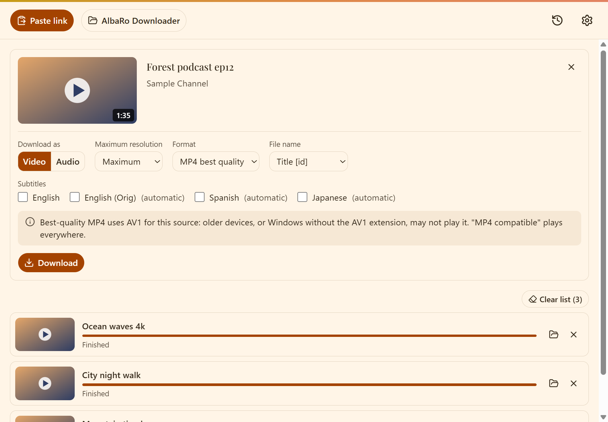
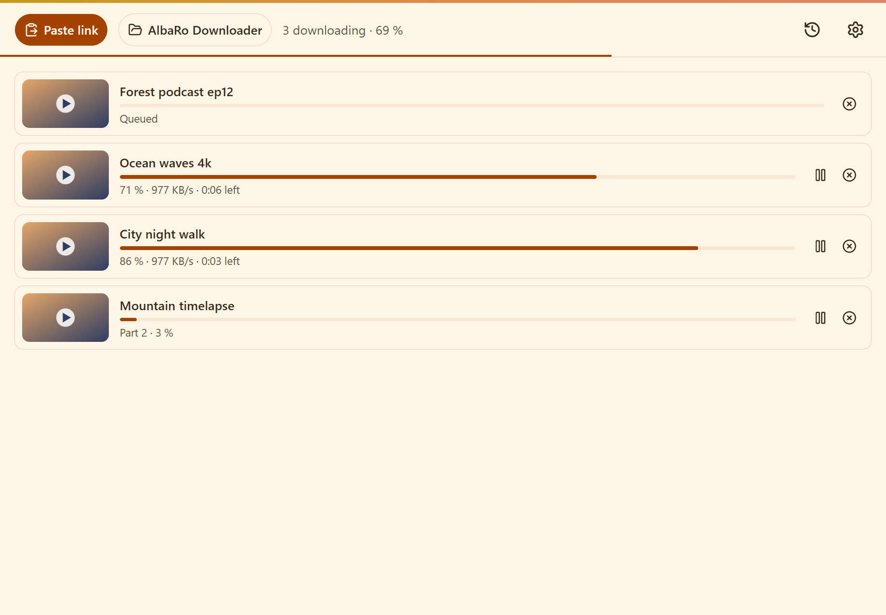
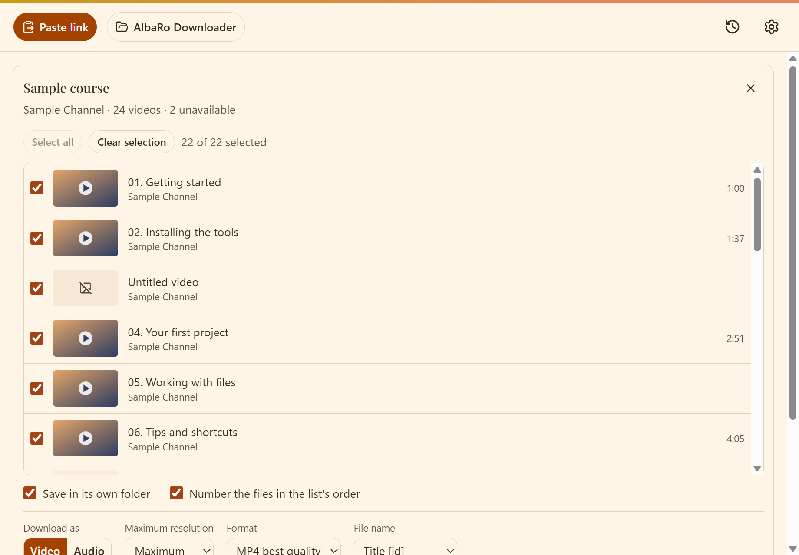

# AlbaRo Downloader

[English](README.md)

Una aplicación de escritorio libre y abierta para descargar vídeo y audio de la web, basada en
[yt-dlp](https://github.com/yt-dlp/yt-dlp) y [FFmpeg](https://ffmpeg.org/). Sin límites de descargas, resolución ni
listas de reproducción, sin cuentas, sin publicidad y sin telemetría.



## Qué hace

- **Vídeo**: la mejor calidad que ofrezca la fuente (4K u 8K si existen). Elige MP4, MP4 compatible (H.264), MKV o
  WebM y una resolución máxima. La app nunca recodifica el vídeo: solo lo reempaqueta (`-c copy`).
- **Audio**: por defecto, el audio original sin recodificar (Opus o AAC); o conviértelo a MP3, M4A, Opus, FLAC o
  WAV. Se incrustan la carátula y los metadatos.
- **Subtítulos**: incrustados en el vídeo, también los automáticos, en los idiomas que elijas.
- **Listas de reproducción y canales**: ves todas las entradas, marcas las que quieres, numeras los ficheros según
  el orden de la lista y los guardas en su propia carpeta. Los vídeos privados o borrados se marcan y se saltan, no
  paran la descarga.
- **Una cola de verdad**: varias descargas a la vez (3 por defecto), pausar, reanudar, cancelar y reintentar. Los
  fallos de red se reintentan con espera creciente, y la cola sobrevive al cierre de la app.
- **Límites a tu gusto**: número de descargas simultáneas y límite de velocidad global.
- **Contenido restringido**: opcionalmente, las cookies de tu navegador o un fichero `cookies.txt`, para vídeos que
  piden iniciar sesión o verificar la edad. Desactivado por defecto.
- **Historial** con búsqueda y filtros, notificaciones del sistema al terminar la cola e icono en la bandeja, para
  que las descargas sigan al cerrar la ventana.
- **Siempre al día**: yt-dlp se actualiza solo en segundo plano (con el checksum verificado), porque los sitios
  cambian a menudo. La app avisa cuando hay una versión nueva de sí misma y nunca la instala sin preguntar.
- Español e inglés, temas claro y oscuro y atajos de teclado.





Las capturas usan el simulador incluido en la app, con títulos inventados y la interfaz en inglés.

## Sitios compatibles

Los que soporte yt-dlp: más de mil sitios, entre ellos YouTube, Vimeo, Twitch, X, TikTok, Instagram, Reddit,
SoundCloud, Bandcamp y Dailymotion. Lo que funciona en cada momento depende de yt-dlp y de los propios sitios, así
que ninguno está garantizado. El contenido con DRM (Netflix, Prime Video, Spotify...) no se soporta.

## Instalación

Descarga el instalador para tu sistema desde la
[página de Releases](https://github.com/AlbaRoDev/Albaro-Downloader/releases).

| Sistema | Fichero | Estado |
| --- | --- | --- |
| Windows 10/11 | instalador `.exe` | Plataforma principal |
| Linux | `.AppImage` o `.deb` | Los construye la CI, aún sin probar en un equipo real |
| macOS | | Todavía no disponible |

**Windows y SmartScreen.** El instalador aún no está firmado, así que SmartScreen puede mostrar "Windows protegió
su PC". Si lo descargaste de la página de Releases, elige *Más información* y luego *Ejecutar de todas formas*.
Cada release indica el checksum SHA-256 de sus instaladores: compáralo con el de tu fichero
(`Get-FileHash <fichero>` en PowerShell) si quieres asegurarte de que no se ha modificado.

yt-dlp, FFmpeg y Deno van incluidos: no hay que instalar nada más.

## Uso responsable

AlbaRo Downloader es una herramienta, y lo que descargues con ella es responsabilidad tuya.

- Descarga solo lo que tengas derecho a descargar: tu propio contenido, contenido con una licencia que lo permita
  (como Creative Commons), obras de dominio público, o copias que puedas hacer para uso personal donde tu
  legislación lo permita.
- Respeta las condiciones de uso de los sitios y la ley de propiedad intelectual. Muchos sitios prohíben descargar
  en sus condiciones, y descargar o compartir obras con copyright sin permiso puede ser ilegal donde vives.
- La app no salta el DRM ni ayuda a hacerlo.
- No la uses para sobrecargar un sitio: la app limita su propio ritmo de peticiones y no debes saltarte ese límite.

Los autores no fomentan ni se hacen responsables de ningún mal uso. Esto no es asesoramiento legal. El software se
ofrece "tal cual", sin garantía de ningún tipo (ver [LICENSE](LICENSE)). AlbaRo Downloader no está afiliado, ni
respaldado ni patrocinado por YouTube, Google ni ningún otro sitio, ni por los proyectos yt-dlp, FFmpeg o Deno.
Todas las marcas pertenecen a sus dueños.

## Privacidad

No hay cuentas, analíticas ni telemetría. Tu historial, tu cola y tus ajustes se quedan en una base de datos local
en tu ordenador. La app solo se conecta a:

- los sitios de los que descargas, y las miniaturas que sirven;
- GitHub, para buscar versiones nuevas de yt-dlp y de la propia app.

Si usas las cookies de tu navegador o un fichero `cookies.txt`, se leen en local y yt-dlp solo las envía al sitio
del que descargas. Para cada descarga la app trabaja con una copia privada del fichero y la borra al terminar.

## Seguridad

¿Has encontrado una vulnerabilidad? Avísala en privado, como se explica en [SECURITY.md](SECURITY.md).

## Compilar desde el código

Necesitas [Node.js](https://nodejs.org/) 24, [pnpm](https://pnpm.io/) 12, [Rust](https://rustup.rs/) estable y los
[requisitos de Tauri](https://v2.tauri.app/start/prerequisites/) de tu sistema.

```sh
pnpm install
pnpm sidecars      # descarga yt-dlp, FFmpeg y Deno en src-tauri/binaries/
pnpm tauri dev     # ejecuta la app
pnpm tauri build   # construye el instalador
```

Comprobaciones: `pnpm lint`, `pnpm typecheck`, `pnpm test` y, en `src-tauri/`: `cargo fmt --check`,
`cargo clippy --all-targets -- -D warnings` y `cargo test`. `pnpm dev` ejecuta solo la interfaz en un navegador, con
un backend simulado.

El stack es Tauri 2 (Rust) con React, TypeScript y Tailwind, y SQLite para la cola y el historial.

## Licencia

El código de AlbaRo Downloader se publica bajo la [licencia MIT](LICENSE). Los programas y bibliotecas incluidos
mantienen sus propias licencias, listadas en [THIRD_PARTY_NOTICES.txt](THIRD_PARTY_NOTICES.txt). FFmpeg lo compila este proyecto
([`scripts/build-ffmpeg.sh`](scripts/build-ffmpeg.sh)) desde el código oficial y solo con bibliotecas compatibles con la
LGPL (libmp3lame, libopus, zlib), así que `ffmpeg` y `ffprobe` son LGPL. Son programas aparte que puedes sustituir, y su
código fuente está en <https://github.com/FFmpeg/FFmpeg>.
